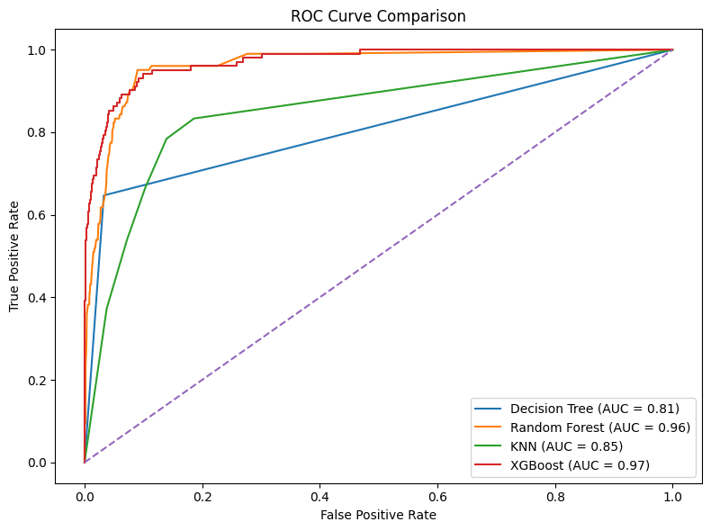
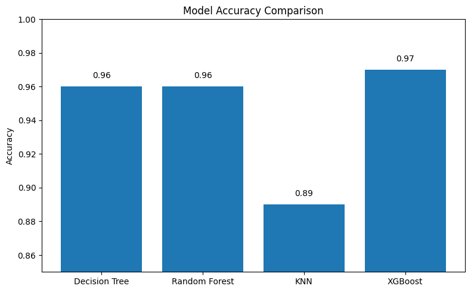
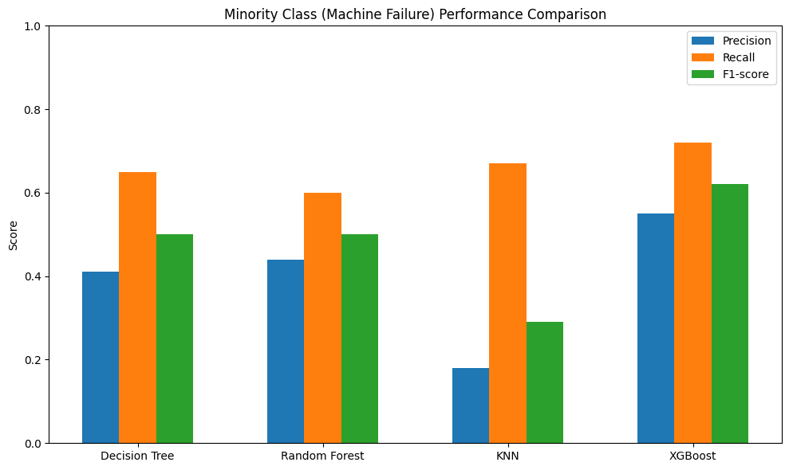
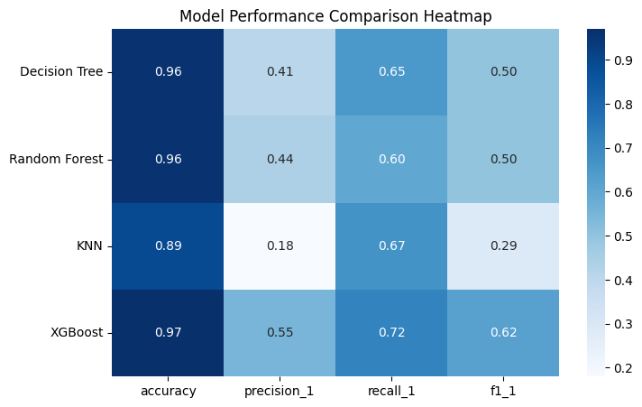
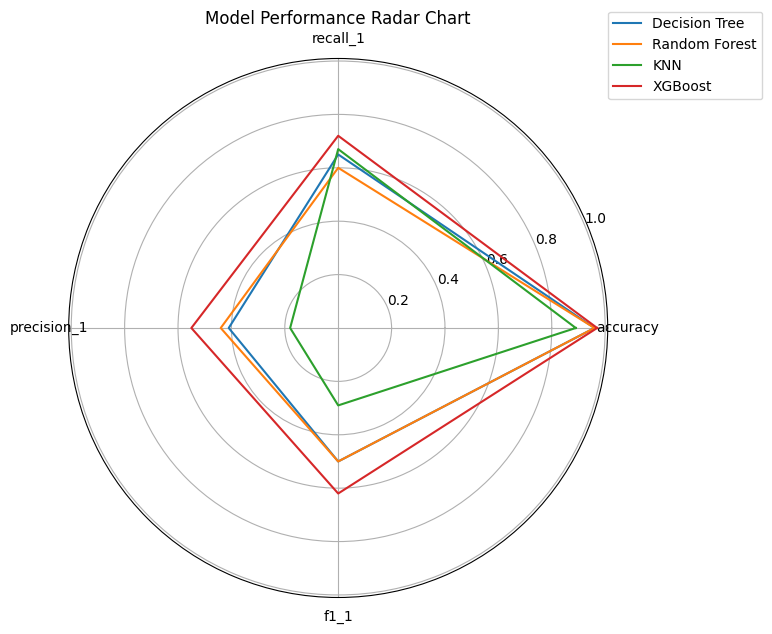
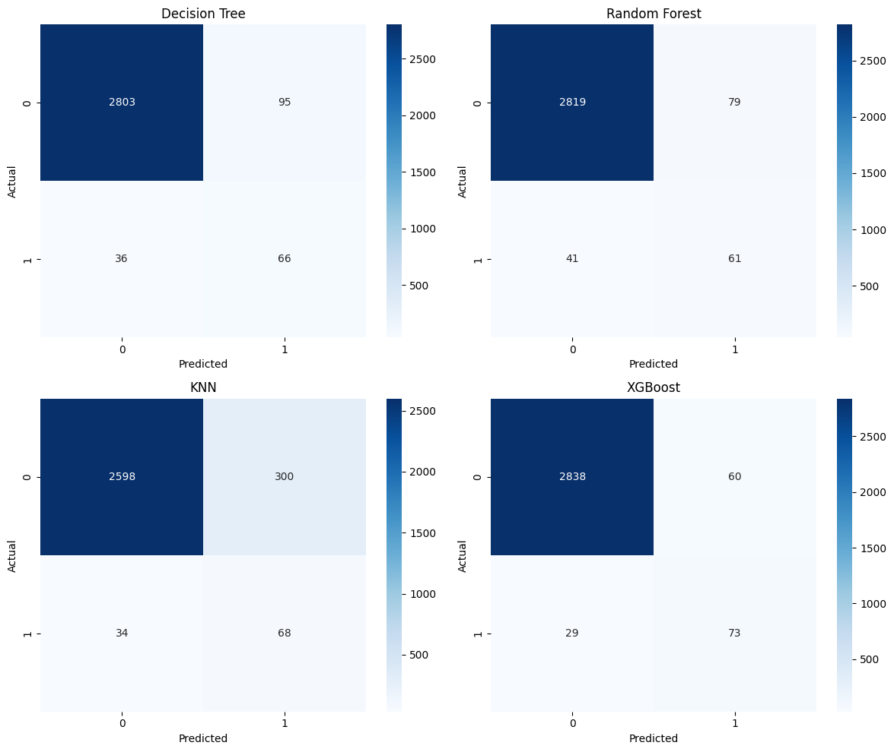
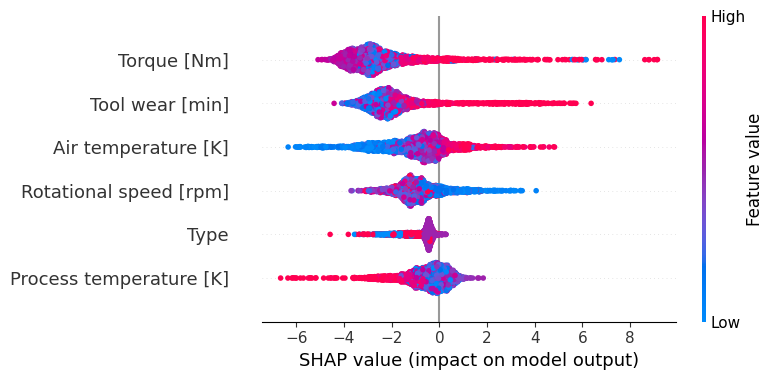
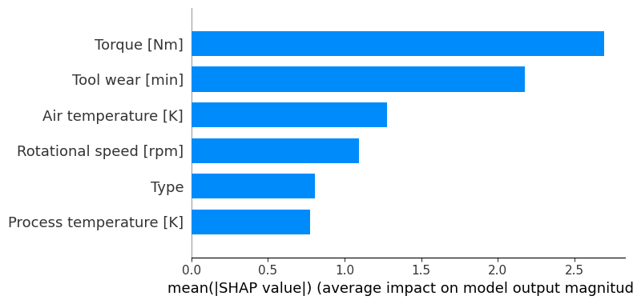
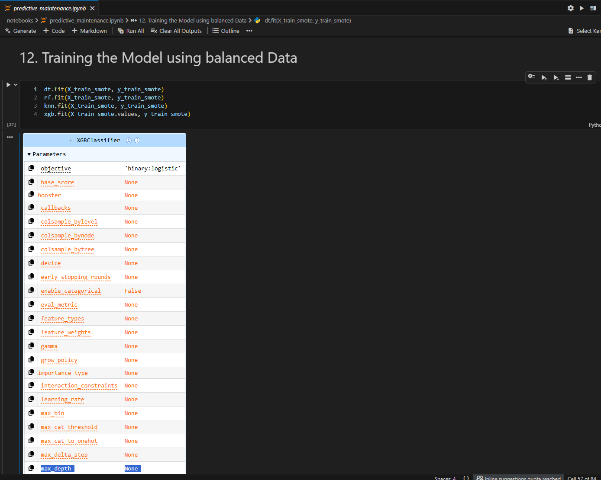

# Predictive Maintenance in Manufacturing Using Big Data Analytics

A machine learning project that predicts **machine failure** in a manufacturing setting from sensor and operating-condition data. Four classifiers (Decision Tree, Random Forest, KNN and XGBoost) are trained on SMOTE-balanced data and compared, with SHAP used to explain what drives failures.

> MSc Big Data Analytics, Big Data Analytics Applications, Victoria University Kampala



## Table of Contents
- [Problem Statement](#problem-statement)
- [Research Questions](#research-questions)
- [Data](#data)
- [Methodology](#methodology)
- [Results](#results)
- [Interpretability](#interpretability)
- [Literature and Research Gaps](#literature-and-research-gaps)
- [Expected Impact](#expected-impact)
- [Limitations and Ethics](#limitations-and-ethics)
- [Supporting Literature Review](#supporting-literature-review)
- [Getting Started](#getting-started)
- [References](#references)

## Problem Statement

Manufacturing lines generate large, fast and varied data from sensors, production systems, maintenance logs and quality inspections. Much of it goes unused, so maintenance is still **reactive** (after a breakdown) or **fixed-schedule**. This leads to:

- Unplanned downtime and lost production
- Higher maintenance costs from emergency repairs
- Shorter equipment life
- Little real-time visibility into production performance
- Defects found after production rather than prevented during it

A **big data approach** is justified by the **volume** of continuous machine data, the **velocity** of sensor streams, and the **variety** of formats (structured tables, time-series, semi-structured logs, unstructured notes and images).

## Research Questions

1. How can multi-source manufacturing data be used with big data analytics to improve predictive maintenance decisions?
2. What hidden patterns and relationships in manufacturing data can predict machine failures and reduce unplanned downtime?

## Data

The target variable is **Machine Failure** (binary). Input features are operating conditions:

| Feature | Description |
| --- | --- |
| `Type` | Product quality variant |
| Air temperature [K] | Ambient temperature |
| Process temperature [K] | Process temperature |
| Rotational speed [rpm] | Spindle speed |
| Torque [Nm] | Mechanical load |
| Tool wear [min] | Accumulated tool wear |

The dataset is the **AI4I 2020 Predictive Maintenance Dataset** (UCI Machine Learning Repository), a synthetic dataset that mimics real industrial machine data. Failures are rare, so the classes are **highly imbalanced**.

## Methodology

The workflow follows the **CRISP-DM** framework:

1. **Preprocessing:** remove leakage-related columns (`TWF`, `HDF`, `PWF`, `OSF`, `RNF`) so the models cannot learn from the failure-mode flags directly
2. **Split:** stratified **70/30** train-test split
3. **Class balancing:** **SMOTE** applied to the training set only
4. **Modelling:** four supervised classifiers
5. **Evaluation:** accuracy, precision, recall, F1 for the failure class, confusion matrices and ROC / AUC
6. **Interpretation:** SHAP values for global and local explanations

| Model | Why it was chosen |
| --- | --- |
| Decision Tree | Interpretable, gives explicit rules for root-cause analysis |
| Random Forest | Reduces variance and handles non-linear relationships |
| K-Nearest Neighbours | Simple distance-based baseline |
| XGBoost | Gradient boosting for complex non-linear interactions and high accuracy |

False negatives are given special attention in evaluation, because a missed failure is the costly error in maintenance.

## Results

| Model | Accuracy | Precision (failure) | Recall (failure) | F1 (failure) |
| --- | --- | --- | --- | --- |
| Decision Tree | 0.96 | 0.41 | 0.65 | 0.50 |
| Random Forest | 0.96 | 0.44 | 0.60 | 0.50 |
| KNN | 0.89 | 0.18 | 0.67 | 0.29 |
| **XGBoost** | **0.97** | **0.55** | **0.72** | **0.62** |

| Model | Macro F1 | Weighted F1 | Rank |
| --- | --- | --- | --- |
| XGBoost | 0.80 | 0.97 | 1 |
| Random Forest | 0.74 | 0.96 | 2 |
| Decision Tree | 0.74 | 0.96 | 3 |
| KNN | 0.61 | 0.92 | 4 |

**XGBoost performed best overall**, with the highest accuracy, the best failure-class F1 and an AUC of about 0.97. KNN was weakest, with many false positives.

<table>
  <tr>
    <td></td>
    <td></td>
  </tr>
  <tr>
    <td></td>
    <td></td>
  </tr>
</table>

### Confusion matrices


### ROC curves

| Model | AUC |
| --- | --- |
| Decision Tree | 0.81 |
| Random Forest | 0.96 |
| KNN | 0.85 |
| XGBoost | 0.97 |


## Interpretability

SHAP analysis shows that **higher torque and greater tool wear raise the probability of failure**, while stable rotational speed is associated with normal operation.

<table>
  <tr>
    <td></td>
    <td></td>
  </tr>
</table>

**Key patterns**
- Operational stress (torque and tool wear) is strongly linked to failure
- Failure is driven by **non-linear** interactions, so tree-based models outperform distance-based ones
- Class imbalance lowers precision and recall for the failure class across all models

## Literature and Research Gaps

Existing predictive-maintenance work falls into three groups:

| Approach | Example | Strength | Weakness |
| --- | --- | --- | --- |
| IoT + machine learning | Rosati et al. (2022) | Real-time monitoring, Random Forest on KPIs | Depends on labelled, high-quality data |
| Deep learning RUL | Go Muan Sang et al. (n.d.) | LSTM-based remaining useful life plus maintenance scheduling | Black-box models, heavy computation |
| CRISP-DM multi-source data science | Duan et al. (2022) | Interpretable, uses alarm and event logs | Mostly descriptive rather than predictive |

**Gaps identified:** over-reliance on single-source sensor data, weak integration of MES / alarm / maintenance data, limited interpretability, under-use of alarm logs for prediction, focus on binary or RUL targets rather than multi-class failure types, and a lack of end-to-end decision-support frameworks.

## Expected Impact

- Fewer unplanned stoppages through early failure warnings
- Lower maintenance cost by servicing on condition rather than on a fixed schedule
- Better production planning and resource allocation
- Earlier detection of process conditions that cause defects
- Longer equipment life

## Limitations and Ethics

**Limitations**
- Synthetic, single-source data limits how far results generalise to real plants
- Rare failures make the data imbalanced, and SMOTE only partly compensates
- Precision for the failure class is moderate (0.55 for the best model), so false alarms remain
- Models rely on historical patterns and need retraining as conditions change
- Real-time deployment (streaming, latency, system integration) was not tested
- XGBoost is only partly interpretable

**Ethical considerations**
- Data privacy and protection of proprietary operational data
- Bias from unrepresentative or imbalanced training data
- Transparency and explainability for maintenance engineers
- Over-reliance on automation, so humans should stay in the loop
- Workforce impact, addressed through training and upskilling
- Data governance, ownership and audit trails

## Supporting Literature Review

A summary of the review paper [*Big data applications across sectors*](https://doi.org/10.1007/s10462-024-10938-5) (systematic review of 2018 to 2023 literature) covers the 3Vs of big data, the technology ecosystem (Hadoop, Spark, NoSQL, cloud, ML), applications in healthcare, logistics, marketing, smart cities, media, cybersecurity, earth science, industry and education, and cross-cutting concerns such as privacy, security, bias, misinformation, network congestion, inconsistent cyber laws and dependence on technical experts.

## Getting Started

```bash
# 1. Clone the repository
git clone https://github.com/YOUR-USERNAME/YOUR-REPO.git
cd YOUR-REPO

# 2. Install dependencies
pip install pandas numpy scikit-learn imbalanced-learn xgboost shap matplotlib seaborn jupyter

# 3. Download the AI4I 2020 dataset (UCI) and place the CSV in the project folder

# 4. Open the notebook
jupyter notebook predictive_maintenance.ipynb
```

The notebook trains the four models on SMOTE-balanced data and reproduces the evaluation and SHAP plots.



## References

- Duan, X., Vasudevan, A., Bekar, E. T., Gandhi, K., & Skoogh, A. (2022). A data scientific approach towards predictive maintenance application in manufacturing industry. *Proceedings of SPS2022*. IOS Press. https://doi.org/10.3233/ATDE22014
- Rosati, R., et al. (2022). IoT- and machine learning-based decision support system for predictive maintenance in Industry 4.0 manufacturing environments.
- Go Muan Sang, L. X., & de Vrieze, P. (n.d.). Predictive Maintenance Model for Industry 4.0 (PMMI 4.0).
- Review paper: https://doi.org/10.1007/s10462-024-10938-5

## Author

**Registration No:** VU-MBD-2511-0359-WEE · Victoria University Kampala, Uganda
